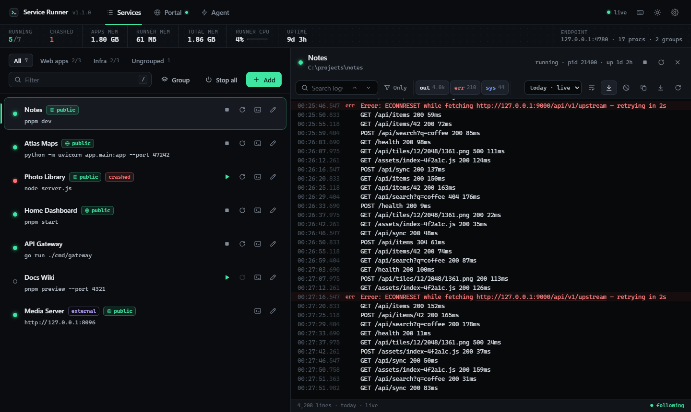
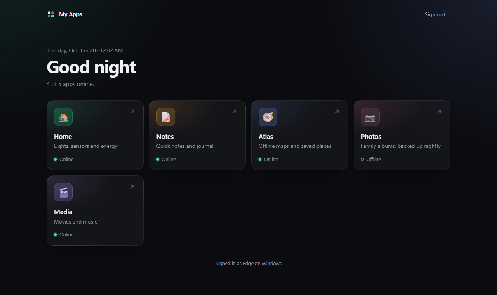

# Service Runner

Windows tray supervisor for local long-running web apps. Open source under the **[MIT License](LICENSE)**.

**Site → [entangledquantum.github.io/service-runner](https://entangledquantum.github.io/service-runner/)**  
Install, uninstall, how it works, and the live UI are all there. This repo is the source.



One local control panel for every long-running app on the machine: start, stop, restart, groups, live logs with search and filters, and an API agents use to register apps. It listens on `127.0.0.1` only.

## Portal — your apps from anywhere



Service Runner can also run a **Portal**: a clean, login-protected home page that publishes the apps you choose to the internet. The control panel itself is never exposed.

- **One access token.** Sign in once per device and stay signed in. The Portal tab lists every signed-in device so you can revoke any of them, and generating a new token signs everyone out.
- **Path-based apps.** Each published app lives under its own path (`/notes`, `/photos`, …) and opens from a tile. WebSockets and streaming work through the proxy.
- **Apps keep their own login.** Paths an app protects itself (mobile APIs, OPDS feeds, …) can bypass the portal login.
- **External apps.** Apps running elsewhere, such as in Docker, can be published too. Service Runner only health-checks them.
- **Tailscale built in.** The Portal tab detects Tailscale. It offers an install button if Tailscale is missing, gives you the one-line Funnel command if the portal isn't exposed yet, and shows your public URL once it's live.

To set it up:

1. Turn on the gateway on the **Portal** tab and generate an access token.
2. In a service's editor, expand **Publish to portal** and pick a path. The app must work behind a path prefix; the portal sends `X-Forwarded-Prefix`.
3. Expose the portal with Tailscale Funnel (`tailscale funnel --bg 4790`) or any tunnel that points at `127.0.0.1:4790`.

The full contract is in [docs/portal-spec.md](docs/portal-spec.md).

## Install (Windows)

```powershell
git clone https://github.com/EntangledQuantum/service-runner.git
cd service-runner
pnpm install
pnpm start
```

That command returns immediately. Close the terminal — Service Runner stays in the tray and comes back at logon. Site: [http://127.0.0.1:4780](http://127.0.0.1:4780). Config: `%LOCALAPPDATA%\ServiceRunner` (never committed).

`pnpm dev` is the only mode that stays attached (debug logs).

## Uninstall

1. Tray → **Quit Service Runner** (stops every child)
2. `pnpm run uninstall:startup` — removes the Windows logon shortcut
3. Optional: delete `%LOCALAPPDATA%\ServiceRunner` and the cloned folder

## License

[MIT](LICENSE) © 2026 EntangledQuantum
